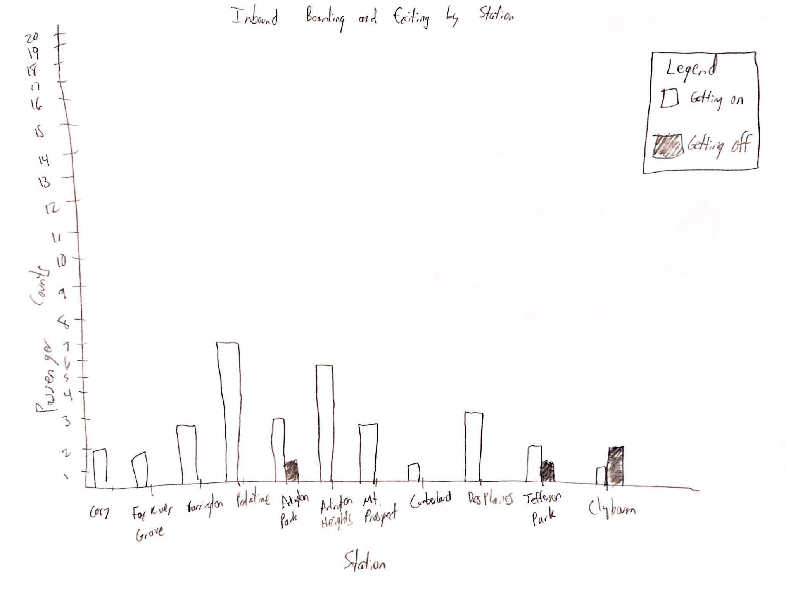
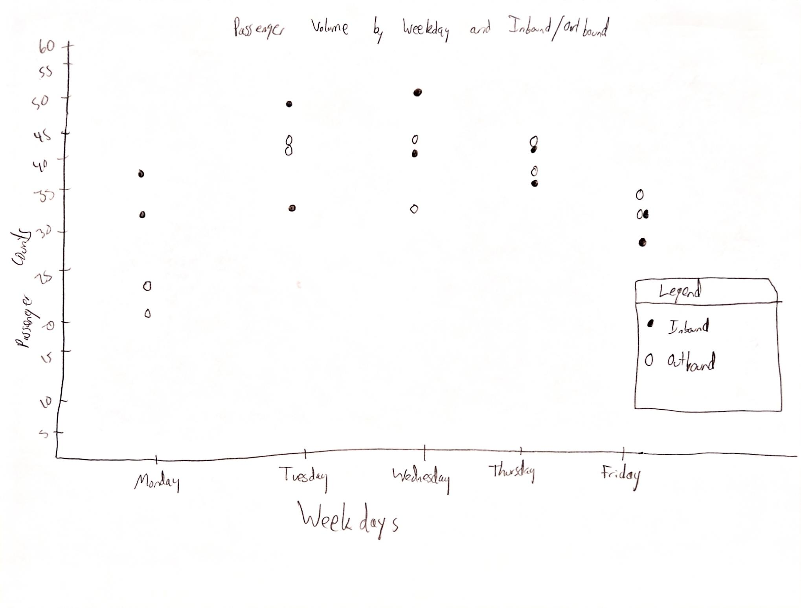
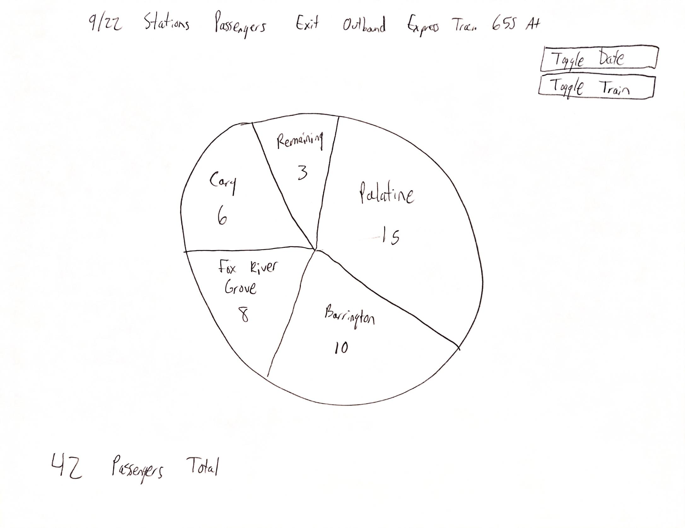
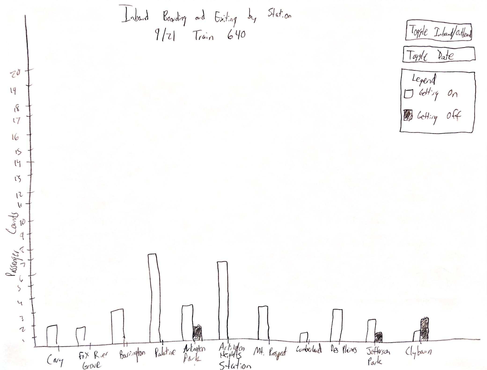
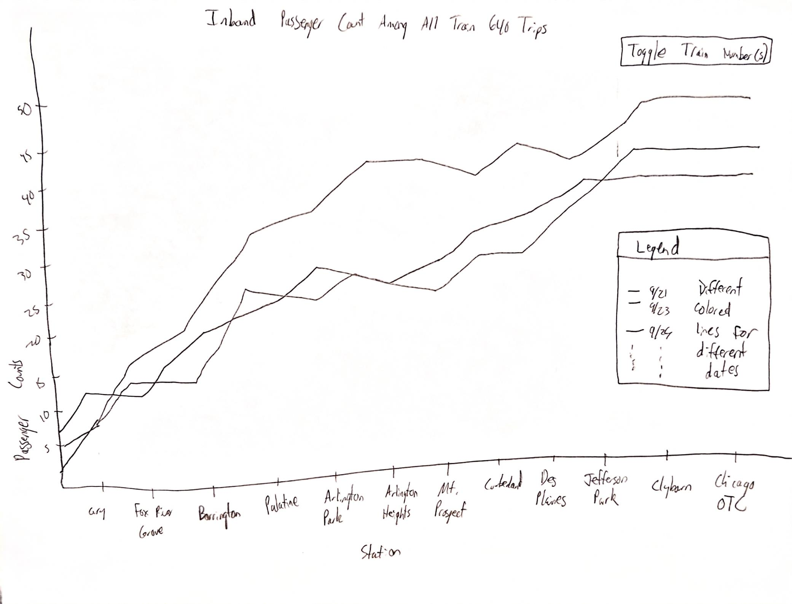

#### Task 1: Observation and data collection plan

The data that I have collected is passenger data for the train rides that I take on my commute to and from UIC every day. I take the UP-NW Metra line from Cary to Chicago OTC. Depending on the day of the week, the inbound and outbound trains that I take are different. I will be recording how many passengers enter and exit the train car that I am in at each stop during my commute. Each individual train ride counts as one observation. I will be recording multiple different attributes for each observation. I will be recording the date, day of the week, train number, departure time, existing passengers prior to me getting on the train, how many passengers get on and off at each stop, and the total passengers left at the final stop. So far I have recorded data over a two week period from 9/21 to 10/1. This means that I have observations spanning over 10 days with a total of 2 observations per day (1 inbound and 1 outbound observation) totaling 20 observations. Additional observations can easily be collected as the semester continues. There exists meaningful variation among the locations, dates, and times of the data collected. I take the 8:24 AM inbound train and the 12:35 PM outbound train on Monday, Wednesday, and Friday. I take the 7:54 AM inbound train and the 5:15 PM outbound train on Tuesday and Thursday. There are 18 possible stops for each train between Cary and Chicago OTC. Four different trains will be observed, and not every train stops at all 18 stops. For example, the 5:15 PM outbound train is express from Chicago OTC and only stops at Palatine, Barrington, and Fox River Grove before I get off at Cary. Since I am working alone, all of the data collection was done by me. The current data collection process fails to capture passenger data outside of the stops observed by my commute. Each observed train has additional stops past Cary that are not able to be observed. Additionally, I am only able to observe the passenger data for the train car that I am in. Each train has multiple cars and it is not possible for me to be in all of them at once. One aspect of the data collection process that could introduce bias is the limited sampling window. So far, I have only had two weeks to collect the data. It is plausible that this limited sampling window will result in bias that would otherwise not be present if I were able to record samples over a longer period of time. The different stop schedules of each train may also introduce bias. The blank entries in the dataset indicate that the train did not stop at that station. If these entries were treated as zeroes, comparisons would be distorted.

Four Domain Questions:

1. How do passenger boarding and exiting counts vary across stations?

2. How does the number of passengers on the train change along the route, and where is occupancy highest?

3. How do passenger volumes differ between inbound and outbound trips?

4. How do boarding, exiting, and occupancy patterns vary by weekday and train service?

The data dictionary is located in data-dictionary.md

#### Task 2: Pilot and data collection

The pilot collection consists of the first ten train rides observed. These were observed from Monday 9/21 to Friday 9/25. Two train rides were observed each day for a total of ten (one inbound and one outbound each day). The observations were not difficult to classify. Classifying whether I was on an inbound or an outbound train was obvious. Sometimes, particularly on the express trains, it was difficult to record how many passengers were getting on and off the train at a particular stop. The most difficult stop to record is Palatine during the 5:15 PM outbound train. Because so many passengers are exiting at this stop, recording accurate counts can sometimes be difficult. It is entirely possible that there are some slightly inaccurate entries in the existing data. Some attributes are missing depending on the train observed. Not every train stops at every station, so some attributes are intentionally left blank. Some of the recorded attributes are redundant. The train number and departure time are technically recording the same information, but I have chosen to leave both in for the sake of completeness.

#### Task 3: Data description and domain questions

The data collected currently shows the passenger data from my commutes to and from UIC from the period of 9/21 to 10/2. The data was recorded by me during my commute, and contains temporal variation based on which train I took to and from UIC on the particular day it was recorded. The specific trains recorded were selected based on what time my first class starts and what time my last class ends on each particular day. For example, on Tuesdays and Thursdays my first class is CS 424. CS 424 starts at 9:30 so I take train 638 which departs Cary at 7:54 to ensure I make it to class on time. There were limitations to the data that I was able to collect. As was mentioned earlier, I am only able to ride one train at a time and am only able to record the passenger data for the train car that I am physically located in. These physical limitations could potentially introduce bias in the data. I discussed earlier that sometimes the passenger data was difficult to record when there were a lot of passengers entering or exiting at the same stop. This was particularly true on express trains that visited fewer stops. Generally speaking, the more passengers that got on or off at a particular stop, the more difficult it was to accurately record the appropriate counts. When making the observations, I recorded the number of passengers that got on or off at a particular stop using the notes app on my phone. I was then able to transcribe those values into an Excel spreadsheet and total them to get an accurate total for how many passengers total either got on or off at Chicago OTC. 

Domain Questions from Task 1:

1. How do passenger boarding and exiting counts vary across stations?

2. How does the number of passengers on the train change along the route, and where is occupancy highest?

3. How do passenger volumes differ between inbound and outbound trips?

4. How do boarding, exiting, and occupancy patterns vary by weekday and train service?

I will be moving forward with domain questions 1, 2, and 4 from Task 1 during the visualization stages. These questions do not need to be revised after the data collection process. Question 1 is the most straightforward. Investigating the different counts of passenger boarding across each station is a good starting point for the visualizations. Question 2 investigates how the total number of passengers changes along the train route as well as where occupancy is the highest. The occupancy portion of Question 2 will apply more to the outbound trains, as the inbound trains are likely to have the highest occupancy at the final stop Chicago OTC. Question 4 analyzes passenger data variation based on weekday. This is a good question to include because many commuters don't need to go into the office every day. Many office workers now have hybrid work schedules meaning that they work from home some days of the week. This affects the passenger data on each weekday and makes Question 4 an interesting inclusion. I have decided to replace Question 3 with a more interesting domain question: How do passenger volumes differ between express and non-express trains? I believe that this revised Question 3 will provide more interesting visualization and analysis. I currently am recording observations for express and non-express trains, so having a question designed to compare them will be good.

Revised Domain Questions:

1. How do passenger boarding and exiting counts vary across stations?

2. How does the number of passengers on the train change along the route, and where is occupancy highest?

3. How do passenger volumes differ between express and non-express trains?

4. How do boarding, exiting, and occupancy patterns vary by weekday and train service?

#### Task 4: Task abstractions

1. How do passenger boarding and exiting counts vary across stations?
    Actions: Compare, rank, and identify extremes
    Targets: Boarding and exiting counts grouped by location, with trip direction and service as context
    Abstract Task: Compare two quantitative measures across locations and identify locations with unusually high or low values.

I mapped Domain Question 1 to comparison because its main goal is to understand differences between stations. Ranking and identifying extremes make that goal more specific: a user should be able to determine which locations have the most boarding or exiting activity. Boarding and exiting are separate targets because a station may have high counts for one action and low counts for the other. When summarizing multiple trips, average counts per observed stop allow comparisons without favoring stations that were visited more often. Skipped stops should be excluded from those averages rather than counted as zero. This abstraction shifted my focus from listing station counts to comparing activity at locations under comparable conditions.

2. How does the number of passengers on the train change along the route, and where is occupancy highest?
    Actions: Derive cumulative values, follow changes, and locate maxima
    Targets: Passenger counts along an ordered sequence of stops within each trip
    Abstract Task: Examine how a cumulative quantity changes through a sequence and identify its peak value and position.

I mapped Domain Question 2 to following a sequence because stop order is essential to understanding how the passenger count changes. The target is a derived cumulative quantity, rather than the individual boarding or exiting counts. For an inbound trip, the calculation starts with existing passengers before Cary. For an outbound trip, it starts with passengers boarding at Chicago OTC. Each subsequent count adds boardings and subtracts exits. Locating the maximum answers both how high the count becomes and where that happens. This abstraction helped me distinguish passenger movement at a stop from the number of passengers present between stops.

3. How do passenger volumes differ between express and non-express trains?
    Actions: Group, summarize, and compare
    Targets: Trip-level boarding totals and peak passenger counts grouped by service category
    Abstract Task: Compare the typical values and variation of quantitative measures between two categories.

I mapped Domain Question 3 to comparison between categories because express and non-express are service labels. The phrase "passenger volumes" needs a consistent definition, so I chose total boardings during the observed commute and peak passenger count as two complementary measures. Total boardings describe how many passengers enter the car over the observed segment, while the peak describes its greatest passenger load. Comparing typical values and their variation across trips is more informative than comparing group totals when the groups contain different numbers of observations. Service categories can be assigned from the recorded stop patterns. Comparisons should retain direction and departure-time context because those factors also differ between the observed services. This abstraction made the question more precise and showed that an observed difference cannot establish that express service caused it.

4. How do boarding, exiting, and occupancy patterns vary by weekday and train service?
    Actions: Filter, group, compare, and identify recurring patterns
    Targets: Boarding counts, exiting counts, and derived passenger counts grouped by weekday and service identifier
    Abstract Task: Compare quantitative patterns across combinations of categories and determine whether differences recur across observations.

I mapped Domain Question 4 to comparison across combinations of categories because weekday and train service jointly define the groups of interest. Filtering lets a user focus on a service or direction before comparing weekdays, while examining repeated observations helps distinguish a recurring pattern from one unusual trip. The targets include boarding and exiting counts as well as derived passenger counts because these describe different aspects of activity. This abstraction also exposed a limitation: asthe sampling schedule links certain services to certain weekdays due to the sampling schedule being limited by the nature of my commute, so not every weekday-service combination is available. The visualization can support comparisons among the observed combinations, but cannot isolate an independent weekday effect or establish explanations such as hybrid work schedules.

#### Task 5: Visualization sketches

##### Initial sketches

###### Initial sketch 1: Bar sketch

This sketch answers domain question 1. It compares the passnger boarding and exiting counts across each station. The attributes being represented are the individual stations as well as how many passengers get on and off at those stations. The marks being used are the side-by-side bar graphs. The channels are the bar heights and colors. The coloring worked well because it allows an easy way to distinguish whether a passenger is getting on or off at a particular station. Long station labels make the horizontal axis crowded, and omitted stations need to be identified as skipped stops so they are not mistaken for zero activity. The sketch is limited by its inability to filter by date, train and whether the train is inbound or outbound. This limits the ability to best answer domain question one.

###### Initial sketch 2: Plot sketch

This sketch addresses domain question 4 by comparing passenger counts across weekdays. The attributes being represented are the weekday, passenger count for each trip, and whether the trip is inbound or outbound. The marks being used are individual points. The channels are horizontal position for weekday, vertical position for passenger count, and filled or hollow points to distinguish inbound and outbound trips. Showing each trip separately works well because it allows differences between observations on the same weekday to remain visible. Unlike the first sketch, this sketch focuses on variation between trips rather than activity at individual stations. Some points overlap, making them difficult to distinguish, and the passenger count would need to be defined consistently, such as peak occupancy. The sketch also does not distinguish train services, which limits its ability to fully answer domain question 4.

###### Initial sketch 3: Pie sketch

This sketch addresses the exiting portion of domain question 1 by showing the share of passengers exiting at each observed stop on outbound express train 655. The attributes being represented are the station, exiting passenger count, remaining passengers after Cary, date, and train number. The marks being used are pie slices, and the channels are slice angle and area, with labels identifying the stations and counts. The motivation was to show how the passengers are distributed among the exit stops and those who continue beyond Cary. This works well for identifying the largest share, such as Palatine in the sketch, but comparing similarly sized slices is more difficult than comparing bar heights. The remaining-passengers slice is not an exit station and needs to be clearly distinguished. The date and train toggles would allow different trips to be explored, although comparing separate pies would be difficult. Unlike the first two sketches, this design emphasizes parts of a total rather than absolute counts or variation across weekdays.

##### Refined sketches

###### Refined sketch 1: Bar sketch

This refined sketch addresses domain question 1 by improving on the initial bar sketch. It compares boarding and exiting counts at each station for a selected trip. The attributes being represented are the station, boarding count, exiting count, date, train number, and trip direction. The marks being used are side-by-side bars. The channels are horizontal position for station, bar height for passenger count, and unshaded or shaded fill to distinguish getting on from getting off. This refines the first sketch by adding a clear legend and controls for changing the date and direction. The shared baseline works well for comparing counts and identifying stations with the most activity. I expect someone to be able to identify where boarding exceeds exiting and where that relationship reverses. Long station labels make the horizontal axis crowded, and omitted stations need to be identified as skipped stops so they are not mistaken for zero activity. Unlike the pie sketch, this design supports direct comparisons of absolute boarding and exiting counts.

###### Refined sketch 2: Line sketch

This refined sketch addresses domain question 2 and supports domain question 4 by showing how passenger occupancy changes along the route across multiple dates. The attributes being represented are station order, passenger count derived from existing passengers plus boardings minus exits, trip date, and train number. The marks being used are lines connecting passenger counts along each trip. The channels are horizontal position for station order, vertical position for passenger count, and the proposed line colors for different dates. The train-number control would allow services to be selected for comparison, which could also support domain question 3 when express and non-express trips in the same direction are selected. I expect someone to be able to follow changes along the route, locate peak occupancy, and compare whether trips follow similar patterns. Unlike the bar sketch, this design shows the passengers present rather than separate boarding and exiting events. Overlapping lines are difficult to distinguish in the pencil sketch, so the proposed colors would help. The Chicago OTC value should represent passengers arriving before the final exit, and the connecting lines should not imply that passenger counts change continuously between stations.

#### Task 6: Summarizing

My sketches explored four design directions: comparing boarding and exiting counts with bars, showing variation across weekdays with points, showing the distribution of exits with pie slices, and following passenger occupancy along the route with lines. Each direction emphasizes a different aspect of the same observations. The bars focus on passenger activity at individual stations, the points focus on differences between trips, the pie focuses on shares of a total, and the lines focus on how passenger counts accumulate and decrease. Trying these ideas helped me recognize that boarding counts, exiting counts, and occupancy are related but answer different questions. A station can have a large number of exits without being the location where occupancy is highest.

The initial and refined bar sketches are the most readable designs for domain question 1 because the shared baseline makes boarding and exiting counts easy to compare. Their main weakness is scalability: adding stations makes the labels crowded, and adding dates or services as more bars would increase complexity. The refined sketch improves on the initial one by including a legend and date and direction controls, allowing one trip to be examined at a time. However, switching between trips makes simultaneous comparisons more difficult. The pie sketch offers a different perspective on question 1 by showing which stops account for the largest shares of exits. It is compact and expressive for an express trip with few stops, but small differences between slices are harder to judge than differences between bar heights. It would become less readable for a service with many stops. Including remaining passengers also complicates the meaning of the whole, since that slice represents passengers who have not exited within the observed segment.

The refined line sketch is the strongest design for domain question 2. Its ordered station positions make it possible to follow occupancy along the route and locate its maximum. Compared with the bars, the lines communicate the overall shape of a trip more clearly, but they do not directly explain whether a change came from boarding, exiting, or both. Showing multiple dates also supports comparing occupancy patterns for domain question 4. Its weakness is that overlapping lines become difficult to follow as more trips are added, and color alone would eventually be insufficient to distinguish them. Filtering train services reduces that complexity, although it also reduces the amount of information visible at once. The weekday plot complements this design by showing individual trip counts without requiring someone to trace a route. It is simpler for spotting variation within a weekday, but overlapping points and the absence of service identifiers limit its readability and its coverage of question 4.

The sketches answer the revised domain questions with different levels of completeness. Question 1 is covered most directly by the bar sketches, with the pie providing a complementary view of exit shares. Question 2 is covered by the line sketch. Question 3, comparing express and non-express trains, is less addressed by the current sketches and will need to be addressed with future visualizations. Selecting different train numbers in the line sketch could reveal occupancy differences, but none of the sketches explicitly compare both total boardings and peak occupancy by service category. A further refinement could separate express and non-express trips while retaining direction and using the same passenger-count measure. Question 4 is partially addressed by the weekday plot and the multiple-date lines, but comparing boarding, exiting, and occupancy jointly by weekday and service would require clearer service labels and coordinated comparisons. The sketches can reveal patterns in the available observations, but cannot establish that service type or weekday caused those patterns.

Knowing how the data was collected affected which comparisons seemed reasonable. Counts apply only to the car I observed, and skipped stops must remain distinct from stops with zero activity. My commute also links particular services and departure times to particular weekdays, so the designs need to preserve that context rather than suggest that every weekday-service combination was sampled. If I collected the data again, I would record the car's position as well and observe the same services on more weekdays and over more weeks. Broader sampling would support more balanced comparisons. Sketching shifted my perspective from trying to display every column to deciding which measure and comparison would actually help answer each question.

#### Task 7: Collaboration process

I worked alone, so there was no collaboration process. I did all data collection, tasks, and sketches myself.
