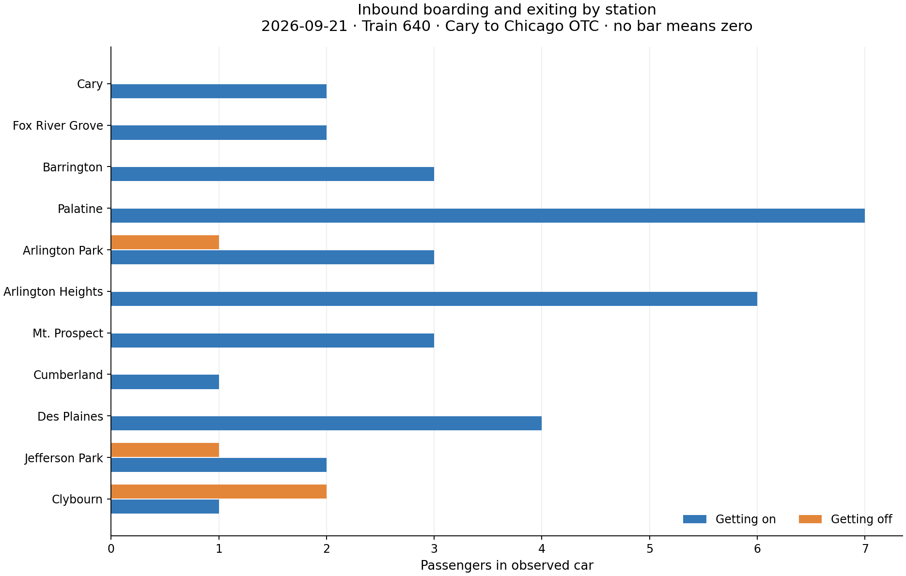
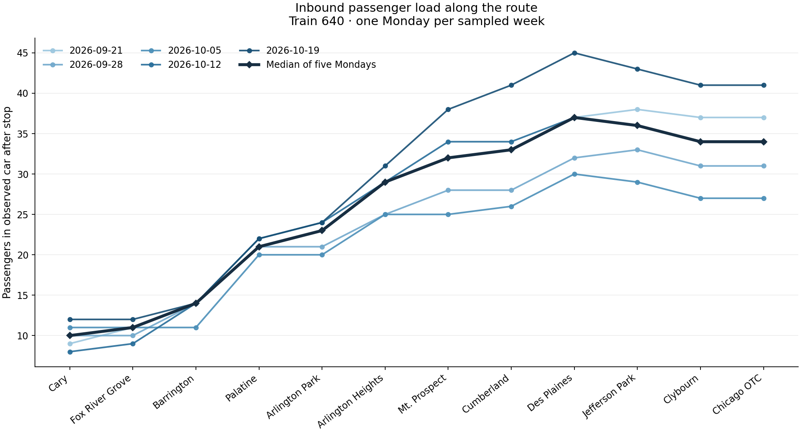
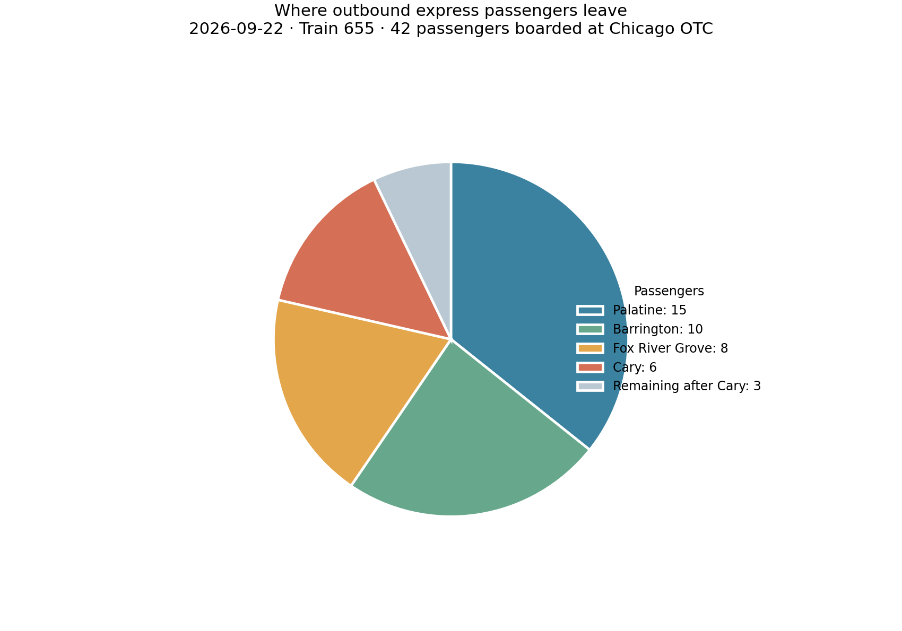
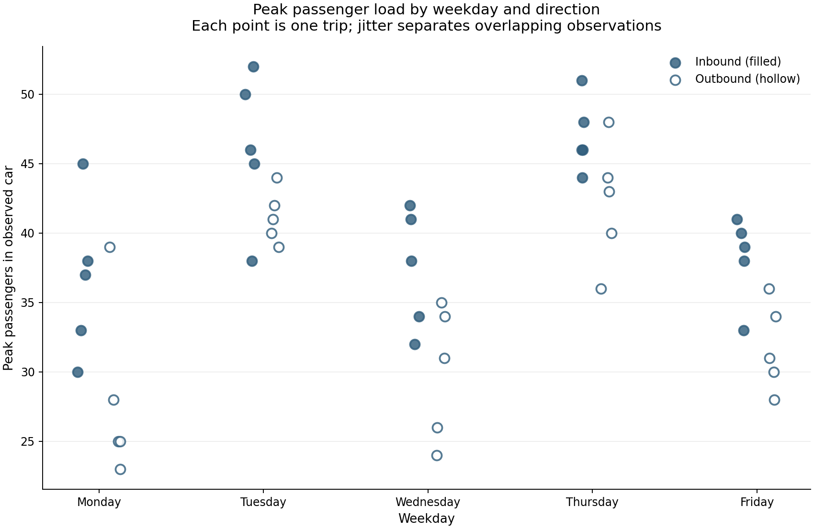
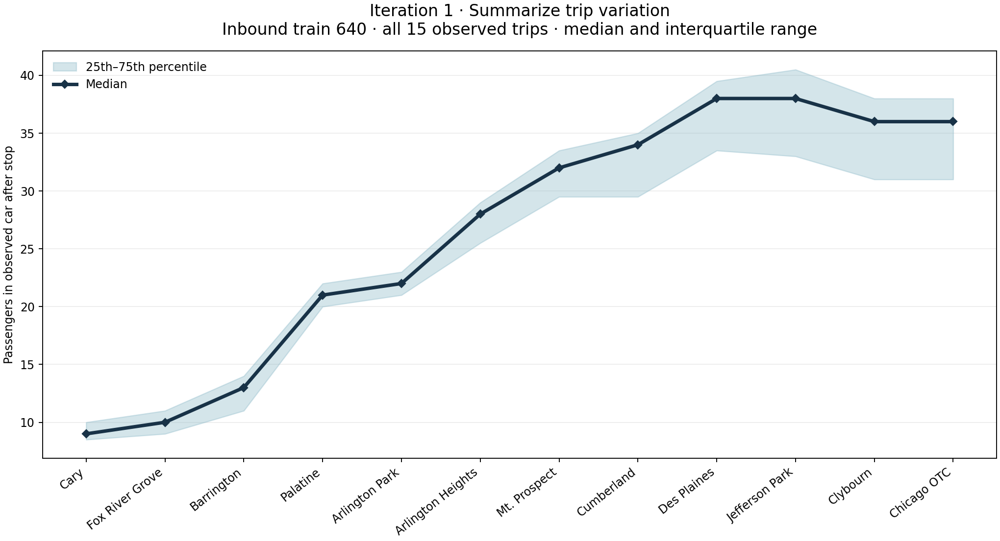
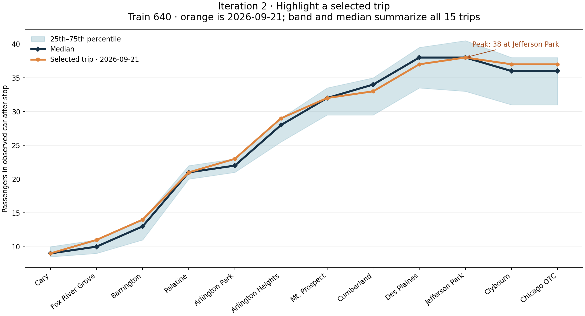

#### Task 1: Revisit your data and questions

Domain Questions from Assignment 1:

1. How do passenger boarding and exiting counts vary across stations?

2. How does the number of passengers on the train change along the route, and where is occupancy highest?

3. How do passenger volumes differ between express and non-express trains?

4. How do boarding, exiting, and occupancy patterns vary by weekday and train service?

Since completing Assignment 1, I have continued to collect passenger data from my commutes to and from UIC. I now have 50 observations spanning 25 inbound and 25 outbound trips recorded on weekdays from September 21 through October 23, 2026. This extends the original two-week, 20-trip sample by 30 trips. The added observations make it possible to see whether patterns recur over several weeks, although the sample still represents only my commute, the train car I rode in, and the stops between Cary and Chicago OTC. Counts were sometimes difficult to observe when many passengers moved at once, so small counting errors are possible.

I double checked the dataset against the data dictionary from Assignment 1 to look for missing or inconsistent values.. Dates, weekday labels, train numbers, and passenger counts are present, and the recorded weekday matches with each date. The calculated passenger totals at the ends of the observed segments also match with the boarding and exiting counts. Blank station cells correspond to stops the train skipped; they are not zero counts. A zero means the train stopped but no one boarded or exited in the observed car. The data dictionary's explanation of blanks and calculated totals is important for interpreting comparisons.

The questions from Assignment 1 remain useful, but I narrowed them to match what this sample can support. The data does not cover every stop on each train's full route, and passenger counts describe one car rather than the whole train. Also, train service is tied to weekday and departure time. Trains 640 and 627 were observed on Monday, Wednesday, and Friday, while trains 638 and 655 were observed on Tuesday and Thursday. Therefore, comparisons can describe the sampled services and weekday-service combinations, but cannot isolate a service effect from a weekday or time-of-day effect. They cannot establish that express service, weekday, or hybrid work schedules caused a difference. This means that I will have to make some adjustments to the domain questions from Assignment 1:

Revised Domain Questions:

1. At the stations served by each observed trip, how do boarding and exiting counts compare across locations?
For this question I will compare stops within compatible directions and services, and exclude skipped stops rather than treating them as zero.

2. How does the passenger count in the observed car change across the stops between Cary and Chicago OTC, and where does it peak on that segment?
For this question I will derive the count after each stop from the starting passengers plus boardings minus exits. The result describes the observed segment, not occupancy over the train's full route.

3. How do total boardings and peak passenger counts compare between the express and non-express services in this sample?
This is a descriptive comparison of the specific sampled trips, interpreted with weekday, departure time, direction, and stop pattern in view.

4. How do boarding, exiting, and passenger-load patterns compare across the weekday-service combinations represented in the sample?
Because weekday and service are linked in the collection schedule, I will not treat their separate effects as distinguishable.


#### Task 2: Prepare the data

I created a Python script at `scripts/prepare_passenger_data.py` for preparing the data. The original `passenger-data.xlsx` remains unchanged. The script reads its `Inbound` and `Outbound` worksheets and writes visualization-ready files to `data/processed/`. It uses only Python's standard library, so no package installation is required. From the repository root, run:

```text
python scripts/prepare_passenger_data.py
```

The script creates two CSV files:

`data/processed/passenger-stops.csv` has one row for each observed station and one arrival checkpoint for each inbound trip. It is in long form, with direction, date, weekday, train, service type, departure time, station order, boardings, exits, and passenger count after the stop. This is the main file for station comparisons and occupancy-over-route visualizations. A blank boarding or exiting value on the inbound Chicago OTC checkpoint means those terminal movement counts were not observed. Its passenger count is the calculated number arriving at the terminal.

`data/processed/trip-summary.csv` has one row per commute, including total recorded boardings, total observed exits, peak passenger count and location, and the passenger count at the end of the observed segment. This supports comparisons between the sampled train services and weekday-service combinations.

The script converts Excel date and time values to ISO dates and `HH:MM` times, and train numbers to categorical text identifiers. It derives weekday from the date only to validate the workbook's weekday label. A mismatch stops processing with an error. It retains zero passenger counts as zero and treats a pair of blank station counts as a skipped stop, omitting that stop from the long-form file. If only one count in a boarding/exiting pair is blank, or if a count is negative or fractional, processing stops with an error. It also checks that each trip's sequential passenger count matches the workbook's inbound terminal total or outbound remaining-passenger count.

Passenger count after each stop is computed from the initial passenger count plus boardings minus exits. For inbound trips, the initial count is `Existing Passengers` before Cary, and the terminal total is retained as a Chicago OTC arrival checkpoint. For outbound trips, the calculated Chicago OTC boarding count is the initial passenger count, and the final value is `Remaining Passengers` after Cary. The script labels trains 640 and 655 as express and 638 and 627 as non-express.

No observations are filtered out, and no outside data is joined. The outputs preserve the observed car and trip coverage, rather than implying counts for an entire train or for stops outside the commute segment. The script validates the current workbook and generated 650 station/checkpoint rows and 50 trip-summary rows. Both generated files can be recreated from the original workbook by rerunning the command above.


#### Task 3: Explore the data

I used four simple exploratory visualizations, generated by `scripts/explore_passenger_data.py` from the processed CSVs from Task 2. After preparing the data with the script 'scripts/prepare_passenger_data.py' from Task 2, run `python scripts/explore_passenger_data.py` from the repository root. The plotting script requires the packages listed in `requirements.txt`. It saves the figures under `figures/exploratory/`.

##### Station boarding and exiting counts


This figure compares the median number boarding and exiting at each served stop, separately for each observed train and direction. It helped show why I should not combine every trip into one station total: the trains stop at different stations, and the station activity is strongly directional. In the inbound sample, boardings are generally more common than exits at the observed stops. Outbound trips show the reverse pattern, with boardings concentrated at Chicago OTC and exits farther along the route. Skipped stops are omitted, and zero medians remain zero. I will retain the per-trip and service context in later comparisons rather than interpreting these medians as route-wide demand.

##### Passenger load along the observed segment


This figure plots the median passenger count and interquartile range at each stop for each train. The inbound profiles generally build toward the city, while outbound loads generally decline toward Cary. There is variation in where the peak occurs, especially for the non-express inbound train, so using only the terminal total would hide where loads were highest during a trip. The markers are not connected: skipped stops and the counts between stations should not be read as observed values.

##### Trip-level boardings and peak passenger counts


Each point represents a trip, and black marks show the median for that train. Total boardings and peak load are related but not interchangeable. For example, outbound non-express trips can have more total boardings over the whole segment than the peak number of people aboard at any one time, because passengers exit along the way. Outbound express trips have most boardings at the origin in this sample, so total boardings and peak load are much closer. Keeping individual trips visible also shows the variation behind the group summaries. There is no obvious single point that warrants removing as an error based on these plots alone.

##### Weekday and train coverage


This coverage matrix made a design limitation especially clear: each weekday is paired with the same train in every observed week. There are no Monday observations for train 638, for example, and no Tuesday observations for train 640. The apparent differences between express and non-express service therefore also reflect weekday and departure-time differences. These plots support descriptive comparisons of the trips collected, but they do not support attributing a difference to service type alone.

The exploration reinforced the revised domain questions. I will compare station activity only among observed stops, examine passenger load across the measured segment, and keep the exact train and weekday context visible. These are exploratory patterns in one observed car over five weeks. I will use later visualizations to present the analysis more deliberately.


#### Task 4: Implement visualization sketches

I implemented four different visualization directions from the Assignment 1 sketches as static figures using `scripts/implement_visualizations.py`. The script reads the processed CSV files and saves its outputs under `figures/implemented/`. Recreate them from the repository root with the following command:

```text
python scripts/implement_visualizations.py
```

##### Direction 1: Refined station bar chart (`barsketch2`)



- **Question/task:** Compare boarding and exiting counts across stations for a selected trip (revised question 1).
- **Attributes:** Station, boardings, exits, date, direction, and train number.
- **Marks and channels:** Paired horizontal bars; station is vertical position, passenger count is bar length, and color distinguishes boarding from exiting.
- **Why this approach:** The sketch's shared baseline makes the two counts at a station easy to compare. I used horizontal bars to make the long station names readable.
- **What worked and what did not:** The largest boarding locations and stops with exits are easy to find. The zero bars are identified in the subtitle, while skipped stops are absent. This view shows only one trip, so it does not show variability or typical station activity across dates.
- **Decision:** Keep this as a single-trip inspection view. For later analysis, add date and service selection or pair it with a clearly labeled multi-trip summary.

##### Direction 2: Passenger-load lines (`linesketch`)



- **Question/task:** Follow passenger load along the observed route and locate where it peaks (revised question 2).
- **Attributes:** Stop order, passengers after each stop, date, and train number.
- **Marks and channels:** Lines connect the sequential counts; stop order maps to horizontal position, passenger count to vertical position, and date to line color. A heavier line shows the median at each stop across the five selected trips.
- **Why this approach:** The line sketch emphasizes route order and makes it possible to see whether load builds, levels off, or falls along the segment.
- **What worked and what did not:** The five Monday trips for train 640 share the same stop pattern, so their profiles can be compared directly; the median helps summarize them. Other weekdays and services are not shown, and line crossings make individual dates harder to follow. Connecting stops can also suggest continuous measurement between stations when the data only records counts at stops.
- **Decision:** Keep and extend this direction, with filters for direction, train, and date. Preserve the distinction between observed stops and values between stops.

##### Direction 3: Exit-share pie chart (`piesketch`)



- **Question/task:** Show how passengers from one outbound express trip are distributed among exit locations and those remaining after Cary (a focused version of revised question 1).
- **Attributes:** Exit counts by station, passengers remaining after Cary, date, and train number.
- **Marks and channels:** Pie sectors; angle and area encode passenger count, with the legend naming each stop and count.
- **Why this approach:** It follows the original sketch's goal of showing the share of passengers leaving at each stop for train 655 on September 22.
- **What worked and what did not:** The largest share of the pie chart, Palatine, is immediately apparent, and the five slices account for the 42 passengers who boarded at Chicago OTC on this express trip. Similar-sized slices are difficult to compare precisely. The remaining-passenger slice is not an exit station, so it mixes a continuation count with station exits.
- **Decision:** Abandon the pie for the main analysis. Use bars for precise comparisons. Retain this as evidence that a part-to-whole view is only suitable for a narrow express-trip example.

##### Direction 4: Weekday scatter (`plotsketch`)



- **Question/task:** Compare trip-level peak passenger loads across weekdays and direction (part of revised question 4).
- **Attributes:** Weekday, peak passenger count, trip direction, date, and train number (train and date are present in the data but not encoded in this first view).
- **Marks and channels:** One circle per trip; weekday maps to horizontal position, peak load to vertical position, and filled versus hollow circles distinguishes inbound from outbound. Small horizontal jitter separates repeated observations.
- **Why this approach:** Individual points show variation from trip to trip instead of hiding it in a weekday average, while the filled/hollow marks preserve the sketch's direction distinction.
- **What worked and what did not:** The spread within each weekday is visible, and the chart makes clear that weekdays do not have equal passenger loads. Some points still overlap. Train identity is omitted, and each weekday is tied to a particular service pattern and departure time, so the plot cannot show an independent weekday effect.
- **Decision:** Keep this direction, but modify the next version to let viewers filter or facet by train and choose a consistent measure. Keep the service/weekday limitation visible.

These implementations show that the sketches led to different useful views: station events, a sequential passenger load, a part-to-whole exit distribution, and trip-level weekday variation. The bar, line, and scatter approaches will inform later visualizations. The pie was useful for testing the idea but is not a good general comparison for this dataset.


#### Task 5: Interaction and multiple views

I built a coordinated interactive version in `visualizations/passenger-explorer.html`, generated from the processed data by `scripts/build_interactive_visualization.py`. Rebuild the page after preparing the CSVs with:

```text
python scripts/build_interactive_visualization.py
```

The page is self-contained and can be opened directly in a browser. The four views work together around trip selection:

- Direction, train, and date controls select one trip. The station bar view and, for outbound trips, the exit-share pie update to that trip.

- The passenger-load view shows trips for the selected direction and train with a median profile. A checkbox adds or hides the individual trip lines so someone can focus on the median or inspect trip-to-trip variation.

- The weekday scatter shows all trips and highlights the selected one. Clicking a point selects that trip in the other views. Its y-variable control switches between peak passenger count and total boardings.

- Hovering a mark shows its date or stop and passenger count, providing details without adding labels to every mark.

These views have related but distinct roles: the bars explain the selected trip's station activity, the line profile gives that trip service context, and the scatter places it among the weekday observations. The pie is available only for outbound trips because its slices are exit locations plus passengers remaining after Cary. For inbound trips it displays a short explanation instead of implying that a pie is meaningful there. The earlier static figures in `figures/implemented/` remain as screenshots of the four initial implementations while the HTML version adds selection and coordinated comparison for further exploration. The interactions help inspect a trip and compare it with observations collected on the same service. They do not remove the sampling limitation: train service and weekday are paired in this dataset, so filtering and highlighting cannot identify separate weekday or service effects.


#### Task 6: Iterate and refine

I chose the passenger-load line view as the strongest direction because it preserves station order and makes it possible to see where passenger load rises, levels off, and peaks. The following are the two substantial refinements I made to the initial line implementation:

##### Iteration 1: Summarize variation across all trips on one service



The initial `linesketch` implementation showed several date-colored trip lines and a median. The individual paths overlapped, the colors made trips difficult to distinguish, and the first rendered version showed only five selected Mondays. I changed the aggregation and scope. This iteration uses all 15 inbound train 640 observations and shows the median passenger count and interquartile range at each stop. I kept the view to one direction and train so that every profile follows the same stop pattern.

This makes the typical load profile and its spread easier to read. For example, the median rises along the route and is highest around Des Plaines and Jefferson Park. The band also shows that variation grows later in the trip. The tradeoff is that a summary can hide the path of a particular unusual trip, which led to the second iteration.

##### Iteration 2: Highlight the selected trip within its service profile



To address the loss of trip-level detail, I overlaid a selected trip in orange against the median and interquartile band, then marked its peak and station. This gives a reader both the service-level distribution and one concrete trip path. The screenshot uses September 21, the same design can be rendered for another selected date.

After preparing the processed CSV files and installing the plotting dependencies from `requirements.txt`, run:

```text
python scripts/render_line_refinement.py
```

This will recreate the two line-chart iterations.


#### Task 7: Current design

The current design is the [refined interactive passenger explorer](visualizations/passenger-explorer-refined.html). It is a separate working HTML visualization generated by `scripts/build_refined_visualization.py`. This is a refined version of the Task 5 explorer at `visualizations/passenger-explorer.html` that brings the Task 6 line-chart iterations into the coordinated set of views.


The explorer supports comparing boardings and exits at the served stops of a selected trip, following its passenger load along the observed segment, and comparing that trip with weekday observations. Direction, train, and date controls select the trip for the station bars, exit-share pie, and line highlight. The line view shows the selected trip in orange, its peak location, the median and interquartile range across trips on the same service, and optional individual trip lines. The weekday scatter switches between peak passengers and total boardings; clicking a point selects that trip across the other views. The pie is available for outbound trips only and shows exits by station plus passengers remaining after Cary.

The main design decisions are to use horizontal paired bars to fit long station labels, preserve route order in the line view, summarize service-level variation with a median and interquartile band while highlighting the selected trip, and show individual weekday observations rather than weekday averages. Coordinated selection lets a user move from the weekday context to one trip's station counts and route profile. Tooltips provide dates, stops, and counts on demand. Compared with Assignment 1, the bars are horizontal rather than vertical, the line view adds a distribution and selected-trip highlight, the pie is restricted to outbound trips, and the scatter uses peak passenger load by default. Compared with Task 4's static figures, the refined page supports trip selection and coordinated interaction.

What currently works well is that a selected trip can be read against both its service distribution and its own route profile, the peak is marked directly, and clicking a weekday point updates the connected views. The individual lines can be turned on for more detail.

I am still unsure whether users will notice that scatter points are selectable, interpret the interquartile band correctly, or find the highlighted trip easy to distinguish from the median and optional lines. The line still connects counts measured at stops, which could imply values between stops. The pie combines station exits with passengers continuing beyond Cary, and the scatter can still have overlapping points. Train service, weekday, and departure time remain paired in the sample, so the visualization cannot support independent effect claims.

For Assignment 3, I would like to further evaluate the aspects of the design that I am still insure about. I am still not 100% certain that I want to include the pie chart in the final visualization. I may decide to remove it or replace it with something else entirely.