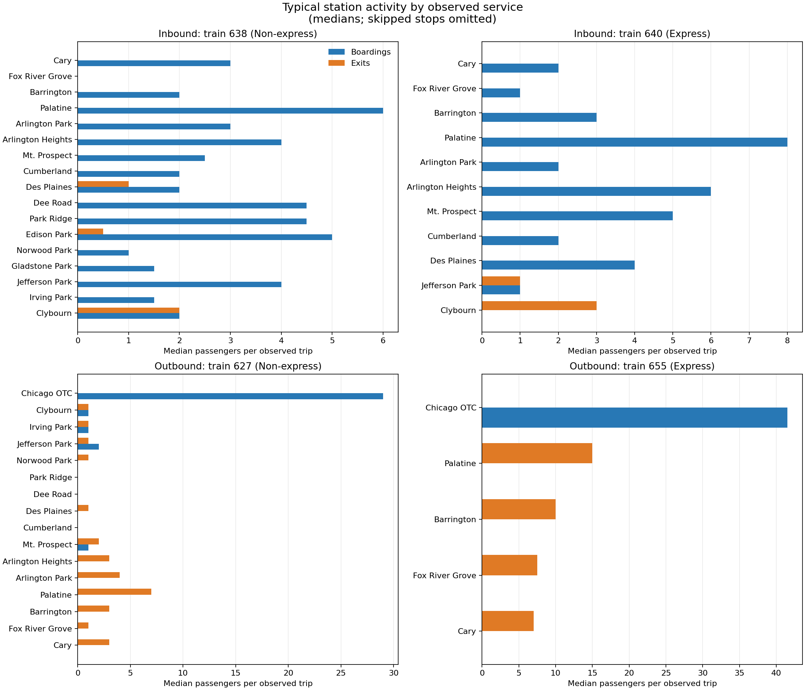
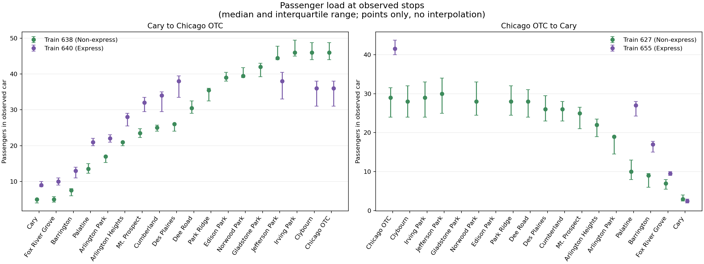
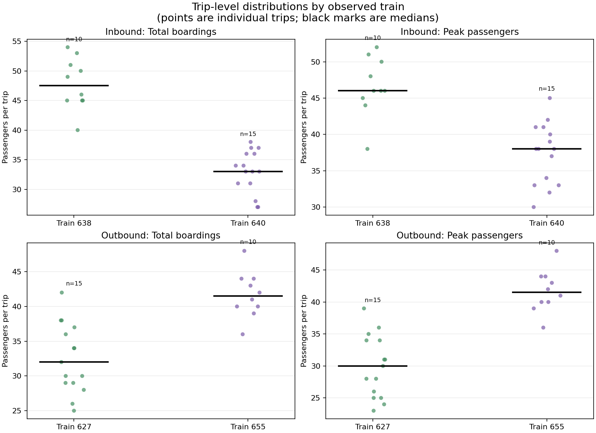
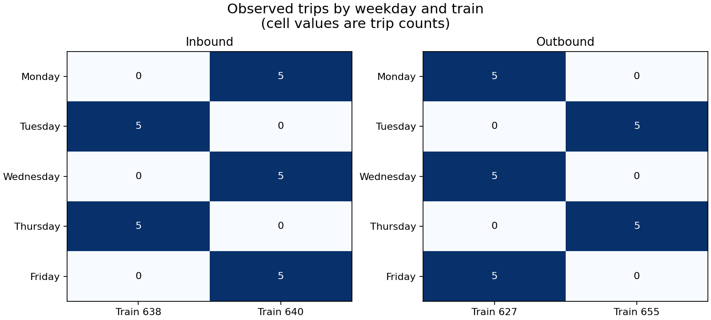

#### Task 1: Revisit your data and questions

Domain Questions from Assignment 1:

1. How do passenger boarding and exiting counts vary across stations?

2. How does the number of passengers on the train change along the route, and where is occupancy highest?

3. How do passenger volumes differ between express and non-express trains?

4. How do boarding, exiting, and occupancy patterns vary by weekday and train service?

Since completing Assignment 1, I have continued to collect passenger data from my commutes to and from UIC. I now have 50 observations spanning 25 inbound and 25 outbound trips recorded on weekdays from September 21 through October 23, 2026. This extends the original two-week, 20-trip sample by 30 trips. The added observations make it possible to see whether patterns recur over several weeks, although the sample still represents only my commute, the train car I rode in, and the stops between Cary and Chicago OTC. Counts were sometimes difficult to observe when many passengers moved at once, so small counting errors are possible.

I double checked the dataset against the data dictionary from Assignment 1 to look for missing or inconsistent values.. Dates, weekday labels, train numbers, and passenger counts are present, and the recorded weekday matches with each date. The calculated passenger totals at the ends of the observed segments also match with the boarding and exiting counts. Blank station cells correspond to stops the train skipped; they are not zero counts. A zero means the train stopped but no one boarded or exited in the observed car. The data dictionary's explanation of blanks and calculated totals is important for interpreting comparisons.

The questions from Assignment 1 remain useful, but I narrowed them to match what this sample can support. The data does not cover every stop on each train's full route, and passenger counts describe one car rather than the whole train. Also, train service is tied to weekday and departure time. Trains 640 and 627 were observed on Monday, Wednesday, and Friday, while trains 638 and 655 were observed on Tuesday and Thursday. Therefore, comparisons can describe the sampled services and weekday-service combinations, but cannot isolate a service effect from a weekday or time-of-day effect. They cannot establish that express service, weekday, or hybrid work schedules caused a difference. This means that I will have to make some adjustments to the domain questions from Assignment 1:

Revised Domain Questions:

1. At the stations served by each observed trip, how do boarding and exiting counts compare across locations?
For this question I will compare stops within compatible directions and services, and exclude skipped stops rather than treating them as zero.

2. How does the passenger count in the observed car change across the stops between Cary and Chicago OTC, and where does it peak on that segment?
For this question I will derive the count after each stop from the starting passengers plus boardings minus exits. The result describes the observed segment, not occupancy over the train's full route.

3. How do total boardings and peak passenger counts compare between the express and non-express services in this sample?
This is a descriptive comparison of the specific sampled trips, interpreted with weekday, departure time, direction, and stop pattern in view.

4. How do boarding, exiting, and passenger-load patterns compare across the weekday-service combinations represented in the sample?
Because weekday and service are linked in the collection schedule, I will not treat their separate effects as distinguishable.


#### Task 2: Prepare the data

I created a Python script at `scripts/prepare_passenger_data.py` for preparing the data. The original `passenger-data.xlsx` remains unchanged. The script reads its `Inbound` and `Outbound` worksheets and writes visualization-ready files to `data/processed/`. It uses only Python's standard library, so no package installation is required. From the repository root, run:

```text
python scripts/prepare_passenger_data.py
```

The script creates two CSV files:

`data/processed/passenger-stops.csv` has one row for each observed station and one arrival checkpoint for each inbound trip. It is in long form, with direction, date, weekday, train, service type, departure time, station order, boardings, exits, and passenger count after the stop. This is the main file for station comparisons and occupancy-over-route visualizations. A blank boarding or exiting value on the inbound Chicago OTC checkpoint means those terminal movement counts were not observed. Its passenger count is the calculated number arriving at the terminal.

`data/processed/trip-summary.csv` has one row per commute, including total recorded boardings, total observed exits, peak passenger count and location, and the passenger count at the end of the observed segment. This supports comparisons between the sampled train services and weekday-service combinations.

The script converts Excel date and time values to ISO dates and `HH:MM` times, and train numbers to categorical text identifiers. It derives weekday from the date only to validate the workbook's weekday label. A mismatch stops processing with an error. It retains zero passenger counts as zero and treats a pair of blank station counts as a skipped stop, omitting that stop from the long-form file. If only one count in a boarding/exiting pair is blank, or if a count is negative or fractional, processing stops with an error. It also checks that each trip's sequential passenger count matches the workbook's inbound terminal total or outbound remaining-passenger count.

Passenger count after each stop is computed from the initial passenger count plus boardings minus exits. For inbound trips, the initial count is `Existing Passengers` before Cary, and the terminal total is retained as a Chicago OTC arrival checkpoint. For outbound trips, the calculated Chicago OTC boarding count is the initial passenger count, and the final value is `Remaining Passengers` after Cary. The script labels trains 640 and 655 as express and 638 and 627 as non-express.

No observations are filtered out, and no outside data is joined. The outputs preserve the observed car and trip coverage, rather than implying counts for an entire train or for stops outside the commute segment. The script validates the current workbook and generated 650 station/checkpoint rows and 50 trip-summary rows. Both generated files can be recreated from the original workbook by rerunning the command above.


#### Task 3: Explore the data

I used four simple exploratory visualizations, generated by `scripts/explore_passenger_data.py` from the processed CSVs from Task 2. After preparing the data with the script 'scripts/prepare_passenger_data.py' from Task 2, run `python scripts/explore_passenger_data.py` from the repository root. The plotting script requires the packages listed in `requirements.txt`. It saves the figures under `figures/exploratory/`.

##### Station boarding and exiting counts



This figure compares the median number boarding and exiting at each served stop, separately for each observed train and direction. It helped show why I should not combine every trip into one station total: the trains stop at different stations, and the station activity is strongly directional. In the inbound sample, boardings are generally more common than exits at the observed stops. Outbound trips show the reverse pattern, with boardings concentrated at Chicago OTC and exits farther along the route. Skipped stops are omitted, and zero medians remain zero. I will retain the per-trip and service context in later comparisons rather than interpreting these medians as route-wide demand.

##### Passenger load along the observed segment



This figure plots the median passenger count and interquartile range at each stop for each train. The inbound profiles generally build toward the city, while outbound loads generally decline toward Cary. There is variation in where the peak occurs, especially for the non-express inbound train, so using only the terminal total would hide where loads were highest during a trip. The markers are not connected: skipped stops and the counts between stations should not be read as observed values.

##### Trip-level boardings and peak passenger counts



Each point represents a trip, and black marks show the median for that train. Total boardings and peak load are related but not interchangeable. For example, outbound non-express trips can have more total boardings over the whole segment than the peak number of people aboard at any one time, because passengers exit along the way. Outbound express trips have most boardings at the origin in this sample, so total boardings and peak load are much closer. Keeping individual trips visible also shows the variation behind the group summaries. There is no obvious single point that warrants removing as an error based on these plots alone.

##### Weekday and train coverage



This coverage matrix made a design limitation especially clear: each weekday is paired with the same train in every observed week. There are no Monday observations for train 638, for example, and no Tuesday observations for train 640. The apparent differences between express and non-express service therefore also reflect weekday and departure-time differences. These plots support descriptive comparisons of the trips collected, but they do not support attributing a difference to service type alone.

The exploration reinforced the revised domain questions. I will compare station activity only among observed stops, examine passenger load across the measured segment, and keep the exact train and weekday context visible. These are exploratory patterns in one observed car over five weeks. I will use later visualizations to present the analysis more deliberately.
