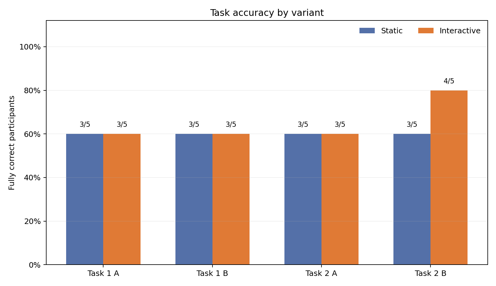
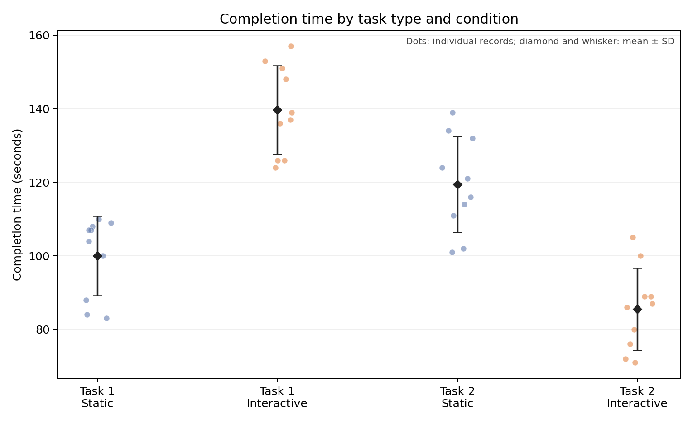

#### Task 1: Implementing interaction

I selected the passenger-load line visualization from Assignment 2. It answers revised domain question 2: how passenger load changes along the observed segment and where it peaks. The data describes one observed train car on the Cary–Chicago OTC segment. Each mark is a recorded passenger count after an observed stop or terminal checkpoint. A connecting line guides the eye along the route and does not represent measurements between stops.

I implemented two versions from the same `data/processed/passenger-stops.csv` and `data/processed/trip-summary.csv` files:

[Static passenger-load overview](visualizations/assignment3-static.html) shows four small multiples, one for each direction and train. Every observed trip profile is drawn in gray, with the median and interquartile range summarized for its service group. The common passenger-count scale supports comparison across the panels. A table lists each trip's date, weekday, peak count, and peak stop. This lets a participant compare all service profiles and inspect trip-level peaks without filtering.

[Interactive passenger-load explorer](visualizations/assignment3-interactive.html) has direction, train, and weekday filters plus a trip selector. Filtering recalculates the median and interquartile range for the displayed subset. Selecting a trip highlights its full route profile in orange and marks its peak. When a weekday is selected, a dashed line preserves the all-weekday median for that train as context. A checkbox reveals the other individual trip profiles.

The weekday filter supports a comparison of observed weekday-service patterns, while the date selector helps locate a trip's peak and compare its path with other trips. The static panels expose those groups and trips together. The interactive version lets a participant focus on a subset and a particular date. Both versions therefore provide the information for the same analytical tasks, with the static version giving an all-at-once overview and the interactive version reducing visual clutter during focused comparisons.

The interaction is available using native keyboard-accessible select controls and a checkbox. The pages are self-contained and can be opened directly in a browser, including from a local copy of the project. Rebuild them from the repository root with:

```text
python scripts/build_assignment3_visualizations.py
```

The sample pairs each train with a fixed set of weekdays and departure time. The weekday comparison is descriptive and cannot establish an independent weekday or service-type effect. The band summarizes the observed trips only, and the profiles represent the sampled car rather than the entire train.

#### Task 2: Evaluation design

##### Evaluation question and hypothesis

**Evaluation question:** 
Does filtering to a weekday/service subset and highlighting a trip help people compare passenger-load patterns more quickly and accurately than reading the static overview?

**Hypothesis:** 
Participants will complete the interactive tasks in less time, with accuracy at least as high as in the static condition. The weekday filter should be most useful for comparing the spread of trip peaks. The train filter should help focus attention on the route profile being compared.

##### Analytical tasks and answer key

Each task has two variants. A participant sees one variant of each task in each condition, never the same variant twice. Both tasks require comparing several observations. Task 1 compares the spread of five trip peaks for each of two weekdays. Task 2 compares median passenger counts at two route locations. Task 1 relates to Assignment 2's weekday-service question, and Task 2 relates to its passenger-load-along-the-route question.

| Task | Variant A | Variant B |
| --- | --- | --- |
| 1. Compare weekday variability in peak load | **Inbound train 638:** For Tuesday and Thursday trips, calculate each weekday's range of trip peak passenger counts (highest minus lowest). Which weekday has the wider range, and by how many passengers? | **Outbound train 655:** For Tuesday and Thursday trips, calculate each weekday's range of trip peak passenger counts (highest minus lowest). Which weekday has the wider range, and by how many passengers? |
| 2. Compare passenger load by location | **Inbound train 640:** Using the all-weekday median profile, compare passengers after Palatine with passengers after Jefferson Park. Which stop has the higher median, and by about how many passengers? | **Inbound train 638:** Using the all-weekday median profile, compare passengers after Palatine with passengers after Jefferson Park. Which stop has the higher median, and by about how many passengers? |

**Researcher answer key (do not show participants before the session):**

- **Task 1A:** Train 638 inbound peaks are Tuesday 50, 52, 38, 45, 46 (range 14) and Thursday 44, 46, 46, 48, 51 (range 7). Tuesday is wider by **7 passengers**.
- **Task 1B:** Train 655 outbound peaks are Tuesday 42, 41, 39, 40, 44 (range 5) and Thursday 44, 40, 36, 43, 48 (range 12). Thursday is wider by **7 passengers**.
- **Task 2A:** Train 640 inbound median counts after Palatine and Jefferson Park are 21 and 38. Jefferson Park is higher by **17 passengers**.
- **Task 2B:** Train 638 inbound median counts after Palatine and Jefferson Park are 13.5 and 44.5. Jefferson Park is higher by **31 passengers**.

For Task 1, score the weekday choice and the difference separately. Accept a difference within 1 passenger of 7. For Task 2, score the higher stop and the reported difference separately. Accept a difference within 2 passengers of the answer key because values must be read from the plotted median. A task is fully correct only when both parts are correct. Keep the component scores to distinguish a comparison error from a chart-reading estimate.

##### Participants, counterbalancing, and procedure

Recruit **10 participants** who are not involved in building the visualization. Use participant IDs P01–P10 and randomly assign participants to the four sequences below in counts of **3, 2, 3, and 2**, respectively. Two participants per sequence would produce only eight participants; the 3, 2, 3, 2 allocation preserves five participants per condition order and five assignments of each task variant to each condition. If the available sample is larger, add participants in balanced blocks of four. Each person uses both versions and answers two questions per version, for four timed tasks total.

| Sequence (3, 2, 3, and 2 participants, respectively) | First condition and task set | Second condition and task set |
| --- | --- | --- |
| 1 | Static, set A (Tasks 1A and 2A) | Interactive, set B (Tasks 1B and 2B) |
| 2 | Static, set B (Tasks 1B and 2B) | Interactive, set A (Tasks 1A and 2A) |
| 3 | Interactive, set A (Tasks 1A and 2A) | Static, set B (Tasks 1B and 2B) |
| 4 | Interactive, set B (Tasks 1B and 2B) | Static, set A (Tasks 1A and 2A) |

This gives five participants each condition order, and each task variant is assigned to each condition equally often. Balance task order within each sequence: for the two sequences with three participants, assign the extra participant to the order that keeps five participants in each first-condition task order overall. Each participant reverses task order in the second condition.

1. Use the same computer, browser, window size, and zoom for everyone. Open the two local HTML pages from Task 1. Both use the same passenger-count axis range. Reset the interactive page before each task. Begin with all weekdays selected, and let participants change controls as needed.
2. Read the participant instructions below. Give a 60-second untimed orientation to the legends and controls using train 627, which does not appear in the scored variants. Do not reveal answers or give correctness feedback. Give the same amount of orientation time for both versions.
3. Present the first condition's two tasks in the assigned order. Start a stopwatch when the task prompt and visualization are visible. Stop when the participant commits to an answer. Allow up to 180 seconds per task. Record an unanswered timeout as 180 seconds and incorrect.
4. Give a one-minute break, switch to the other version, and present its two tasks in the assigned order. Do not revisit or discuss earlier answers.
5. After each answer, ask for confidence on a 1–5 scale (1 = not confident, 5 = very confident). Record the response verbatim and, in the interactive condition, tally filter, date-selection, and checkbox changes.

**Participant instructions:** “The visualization shows passenger counts in one observed train car along the Cary–Chicago OTC segment. Counts are recorded after observed stops. The lines guide the eye between observations. The dark line is the median and the shaded band shows the middle half of the trips. Use the visualization to answer each question. You may use any available controls. Please give your best answer and tell me when you are done.”

##### Pilot and measurements

Before the main sessions, pilot the procedure with two people who will not join the main sample. Use opposite condition orders. Ask them afterward which question or chart element was unclear. Revise wording or orientation if either participant interprets a task differently, cannot locate the required values, or reaches the time limit. Also check that neither task is answered immediately without comparing the requested observations. Keep the answer key and scoring tolerances fixed after piloting begins. If a task needs substantive revision, rerun the pilot with new participants.

Record one row per participant-task in [the evaluation results dataset](evaluation/evaluation-results.csv). The required quantitative measures are **task accuracy** (full correctness and the component scores) and **completion time in seconds**. Confidence and number of interactive control changes are secondary measures. Compare static and interactive results within participant and task type, and report task variants separately as well as pooled by condition. With ten participants, summarize paired differences and individual results. Treat the outcome as a small class evaluation rather than a broad claim about all users.

#### Task 3: Conducting the evaluation

##### Evaluation status and protocol

The evaluation applies the Task 2 protocol to ten anonymous IDs (P01–P10), with four timed tasks per ID and both visualization conditions. Sequences 1–4 have 3, 2, 3, and 2 participants. This results in five static-first and five interactive-first participants, and five assignments of each task variant in each condition. Task order is balanced overall such that five participants see Task 1 before Task 2 in their first condition and five see Task 2 first. Their second-condition order is reversed.

##### Evaluation results

| Task and variant | Static fully correct | Static mean time (s) | Interactive fully correct | Interactive mean time (s) |
| --- | ---: | ---: | ---: | ---: |
| Task 1A | 3/5 | 101.2 | 3/5 | 139.8 |
| Task 1B | 3/5 | 98.8 | 3/5 | 139.6 |
| Task 2A | 3/5 | 124.4 | 3/5 | 86.2 |
| Task 2B | 3/5 | 114.4 | 4/5 | 84.8 |

Pooled across variants, Task 1 was fully correct for 6/10 records in each condition. Mean time for Task 1 was 100.0 seconds in the static condition and 139.7 seconds in the interactive condition. Task 2 was fully correct for 6/10 static records and 7/10 interactive records. Mean time for Task 2 was 119.4 seconds static and 85.5 seconds interactive. Across all 20 task records per condition, full accuracy was 12/20 (60%) static and 13/20 (65%) interactive, with mean times of 109.7 and 112.6 seconds, respectively. The component scores are preserved in the CSV: weekday/stop comparison accuracy is 8/10 for both Task 1 conditions and both Task 2 conditions. Difference accuracy is 8/10 for static and interactive Task 1, 8/10 for static Task 2, and 9/10 for interactive Task 2.

##### Evaluation observations

The evaluation notes suggest a task-dependent pattern. In Task 1, the static peak table makes trip peaks available together, while the interactive version requires filtering by weekday and inspecting individual trips. The interactive records include 6–10 date selections, and 7/10 toggle the individual-trip checkbox. This models extra control work and explains the longer time without an accuracy gain. In Task 2, filtering to a single train models a more focused view and shorter completion times. In both conditions, the median values are read from a line chart rather than printed labels, so estimating the numeric difference remains a source of errors.

#### Task 4: Quantitative analysis

##### Descriptive results

The analysis uses the 40 participant-task rows in [the evaluation results dataset](evaluation/evaluation-results.csv). Each condition has 20 records: ten for Task 1 and ten for Task 2. Every task variant has five observations per condition. Accuracy below means fully correct (both scored answer components correct). component results are reported separately. Completion time is in seconds. No response reached the 180-second timeout.

| Condition | Fully correct | Accuracy | Mean time (SD) | Median time | Time range |
| --- | ---: | ---: | ---: | ---: | ---: |
| Static | 12/20 | 60% | 109.7 (15.3) | 108.5 | 83–139 |
| Interactive | 13/20 | 65% | 112.6 (30.0) | 114.5 | 71–157 |

The five percentage-point accuracy difference is one additional fully correct record out of 20. The interactive time mean is 2.9 seconds higher, while its median is 6 seconds higher. The interactive time range and standard deviation are much larger because the direction of the time difference changes with task type.

##### Accuracy by task and variant



Each bar represents five participants. Task 1 accuracy is 6/10 (60%) in both conditions, and both its weekday-choice and numerical-difference components are correct in 8/10 records per condition. Task 2 is 6/10 (60%) fully correct static and 7/10 (70%) interactive. The stop comparison component is correct in 8/10 records in each condition. The estimated difference is correct in 8/10 static and 9/10 interactive records. By variant, accuracy is 3/5 for both conditions on Task 1A, Task 1B, and Task 2A. Only Task 2B differs: 3/5 static and 4/5 interactive. This modest accuracy gain is concentrated in one five-person variant, rather than appearing across all tasks.

##### Completion time and participant variation



| Task variant | Static mean (SD), seconds | Interactive mean (SD), seconds | Fully correct, static / interactive |
| --- | ---: | ---: | ---: |
| Task 1A | 101.2 (10.9) | 139.8 (14.2) | 3/5 / 3/5 |
| Task 1B | 98.8 (11.8) | 139.6 (11.3) | 3/5 / 3/5 |
| Task 2A | 124.4 (12.2) | 86.2 (9.2) | 3/5 / 3/5 |
| Task 2B | 114.4 (13.1) | 84.8 (14.0) | 3/5 / 4/5 |

For Task 1, the interactive mean is about 40 seconds slower for each variant, with no change in full accuracy. The within-participant comparison points in the same direction for all ten participants: interactive Task 1 took 19–51 seconds longer than that participant's static Task 1. This aligns with the notes that participants had to filter and inspect individual peaks. Date selection and toggling profiles added steps to a question that the static peak table presents together.

For Task 2, interactive times average 38.2 seconds faster on variant A and 29.6 seconds faster on variant B. All ten participants completed their interactive Task 2 faster than their static Task 2, by 13–56 seconds. Full accuracy is unchanged on A and one record higher on B. The filter may have helped focus the profile, while the numeric estimate still depended on reading values from the line chart. The difference component was less reliable than choosing the higher stop, consistent with that reading challenge.

Participant outcomes also vary. Static full-correct counts range from zero to two of two tasks per participant. Interactive counts have the same range. P03 moved from zero fully correct static responses to two interactive responses, while P02 moved from one to zero. Four participants had both interactive tasks fully correct, compared with three for static. These small counts do not suggest a uniform accuracy improvement. P10 had both tasks correct in both conditions, while P02 had no fully correct interactive task. Across the paired task-type comparisons, the opposite task-specific timing effects were consistent for all ten participants.

##### Interpretation and limits

The evaluation question asked whether filtering and highlighting make comparisons faster while preserving accuracy. The observations support that answer for the focused route-location comparison (Task 2), but not for weekday variability (Task 1). The overall mean alone—roughly three seconds slower interactively—hides those large, opposing task effects. There is no clear overall accuracy advantage: the interactive condition has one more fully correct response, mostly attributable to Task 2B, while Task 1 accuracy is identical.

The hypothesis is therefore only partly supported. Interaction appears useful when filtering focuses the participant on one train's profile, but the weekday task's peak table is more direct than repeatedly selecting trips in the interactive view. The results describe these ten participants and these task variants only. Each condition used a different variant for a participant, despite balanced assignment, and the sample is small. The observed differences are descriptive and should not be treated as evidence of a general advantage or statistical significance.

The figures and summary statistics can be regenerated from the CSV with [the analysis script](scripts/analyze_assignment3_evaluation.py): `python scripts/analyze_assignment3_evaluation.py`.

#### Task 5: Reflection and recommendations

The evaluation showed that interaction was useful when it narrowed the display to one train, but it did not help every kind of comparison. For Task 2, all ten participants were faster with the interactive version, and accuracy was similar (six of ten static and seven of ten interactive responses fully correct). The train filter appears to have helped focus attention on the route profile. By contrast, every participant took longer on interactive Task 1, and accuracy remained six of ten in both conditions. This was the clearest surprise: the same controls that supported focused inspection added work to a task that required comparing many trip peaks.

The static overview's main strength was that it exposed the trip peak table and grouped profiles together, making weekday extremes available at once. The interactive view's strength was its ability to isolate a train and redraw the summary for a focused subset. A weakness shared by both versions was the effort needed to estimate exact passenger differences from a line and shared axis. In Task 2, the stop comparison component was correct in eight of ten records per condition, but the difference component was correct in only eight static and nine interactive records. The one-record difference is too small to claim a reliable accuracy gain, but the component results point to numeric reading as a design issue.

I would make three concrete changes. First, I would add a compact weekday summary to the interactive view that lists each weekday's trip peaks, range, and sample count together. Participants could compare the two ranges without selecting trips one at a time. This directly addresses the roughly 40-second interactive slowdown on both Task 1 variants and the date-selection work recorded during those tasks. Second, I would add exact values on hover and a clear value readout for the median at named stops. A comparison mode could show the two selected stop values and their difference. This should reduce visual estimation effort while keeping the overview uncluttered. Third, I would keep the static peak table available as an alternate view and make the requested train and weekday visible in the control state, so users can tell which subset is being summarized. The static table already supported the peak comparison more directly than the implemented date-by-date interaction.

These are proposed changes, not demonstrated improvements. I would evaluate them with the same task goals, measuring whether the new summary reduces Task 1 time without lowering accuracy and whether value readouts reduce Task 2 difference errors. The current findings support retaining interaction for focused route inspection, while treating the static overview as valuable for broad comparison. Showing interaction without a performance benefit on Task 1 is a useful outcome: it identifies where the control design and analytical task do not fit well.

The evaluation has several limits. It includes ten participants, so each task variant contributes only five observations per condition and one participant changes an accuracy rate by 20 percentage points within a variant. The procedure specifies that participants are not involved in building the visualization, but their domain knowledge, chart-reading experience, and familiarity with interactive filters were not recorded. I therefore cannot tell whether those backgrounds affected speed or errors. The tasks also demand different kinds of work: Task 1 requires tracking five observations per weekday and calculating ranges, while Task 2 asks participants to estimate a numeric gap from a plotted line. Their results should not be treated as a pure test of interaction independent of task design.

Condition order was balanced and task order reversed, which helps limit order effects. However, participants answered structurally similar questions in both conditions, so learning the comparison strategy or remembering the chart may have carried over even though the task variants differed. A short orientation was provided, but the evaluation did not measure longer-term learning or whether participants would use the controls more efficiently with practice. Completion time was recorded with a stopwatch and correctness was scored against tolerances. Timing and scoring may include researcher judgment. Finally, the small, single-session evaluation covers these two tasks and the sampled train profiles only. A follow-up with more participants, recorded chart/domain familiarity, and additional task types would help determine whether these patterns persist.
